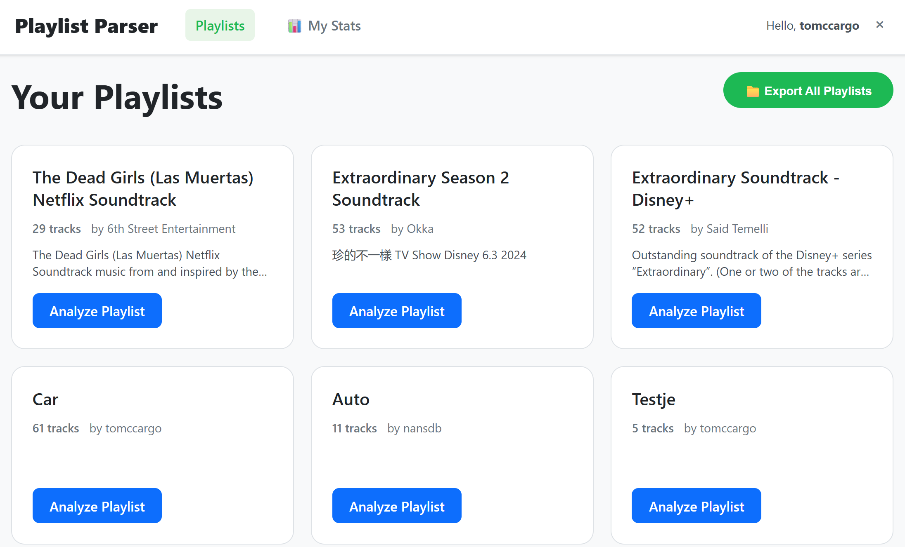
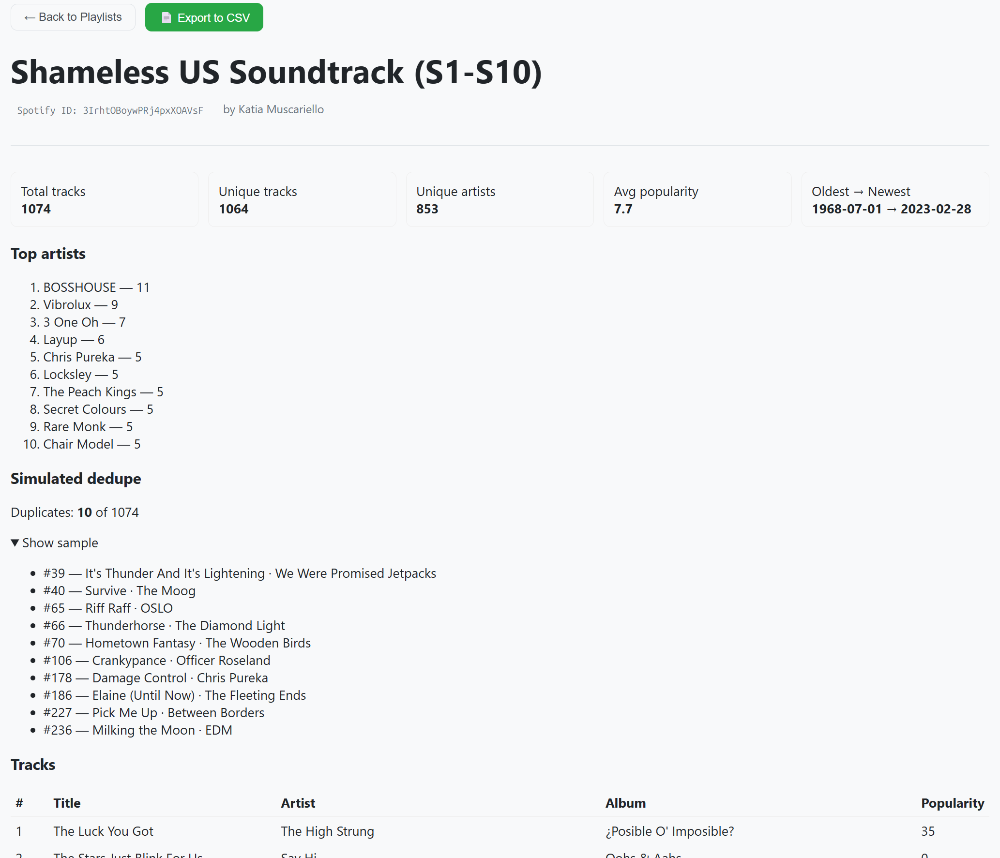

# PXL Playlist Parser

A Spotify playlist analyzer: a Vue 3 frontend and a Fastify + Prisma API backed by PostgreSQL. Log in with Spotify, get statistics for your playlists, look for duplicates, compare two playlists and export everything to CSV. The app never changes your playlists; it only reads them.



## Architecture

| Component | Technology | Notes |
|-----------|------------|-------|
| `frontend/` | Vue 3, Vue Router, Vite | Static single-page app. Calls the API with cookies (`credentials: 'include'`). |
| `api/` | Node.js 22+, Fastify 5, Prisma 7 (node-postgres driver adapter) | Spotify OAuth, statistics, CSV export, Last.fm lookups. Stateless: all state lives in PostgreSQL. |
| Database | PostgreSQL | Users, sessions, encrypted Spotify tokens, export jobs, Last.fm cache. |

External services the API talks to:

- **Spotify Web API** (`accounts.spotify.com`, `api.spotify.com`): required.
- **Last.fm API** (`ws.audioscrobbler.com`): optional, provides listener counts.

## Features

- List your playlists, with your **Liked Songs** pinned first and treated like a playlist (stats, duplicates, export). Playlists you only *follow* are shown but can't be analyzed (see [Spotify limitations](#spotify-limitations)).
- Per-playlist statistics: track/artist counts, top artists and albums, total and average length, explicit percentage, release decades, release range, when tracks were added, contributors on collaborative playlists.
- Last.fm listener counts: average listeners, most-listened tracks and hidden gems. Looked up in the background and cached in the database.
- Duplicate detection: exact duplicates (same Spotify track) and the same recording on different releases (same ISRC).
- Merge simulation between two playlists (API only: `GET /simulate-merge?a=…&b=…`).
- CSV export of one playlist, or of all your playlists as a background job with progress.
- **Insights** page: highlight cards, a like calendar, your top artists over time (4 weeks / 6 months / 1 year), when you listen, and on-demand sections for library growth, music age, artist depth, followed artists, saved albums, podcasts, Liked Songs vs. playlists and unplayable songs.



## Spotify limitations

Spotify changed its Web API for apps in *Development Mode* in February/March 2026. This app follows the new rules:

- The **owner of the Spotify app must have Spotify Premium**, or the app stops working.
- A development-mode app allows **at most 5 users**. Every account other than the owner must be added under *User Management* in the Spotify dashboard, or login fails with "user not allowed".
- Playlist contents are only available for playlists the user **owns or collaborates on**.
- Track `popularity` and the user's `email` are no longer available. Last.fm listener counts replace popularity.

The app requests these read-only scopes: `playlist-read-private`, `playlist-read-collaborative`, `user-library-read` (Liked Songs, saved albums and podcasts), `user-top-read` (top artists and tracks), `user-read-recently-played` (last 50 plays) and `user-follow-read` (followed artists). Users who logged in before a scope was added must log in again; the app asks them to.

## Spotify app setup

1. Go to the [Spotify Developer Dashboard](https://developer.spotify.com/dashboard) and create an app (Web API).
2. Add a **Redirect URI** that points at the API's callback: `<API URL><API_BASE_PATH>/auth/callback`.
   - Locally: `http://127.0.0.1:3000/auth/callback`
   - Spotify only allows plain `http` for loopback IP addresses like `127.0.0.1`. `localhost` is rejected, and every other host must use `https`.
   - The value must match `SPOTIFY_REDIRECT_URI` exactly.
3. Copy the Client ID and Client secret into the API configuration.
4. Add the Spotify accounts that will log in under *User Management*.

## Last.fm setup (optional)

Create an API account at <https://www.last.fm/api/account/create> (the callback URL can stay empty) and set `LASTFM_API_KEY`. Without it the app works, but the playlist page shows that listener stats are unavailable. The key is a server-side secret: it belongs in the API's environment, never in the frontend build.

## Configuration

Everything that differs between environments is configured with environment variables; no code changes are needed. The API validates its configuration at startup and exits with a list of everything that is wrong.

### API (`api/`)

| Variable | Required | Default | Description |
|----------|----------|---------|-------------|
| `DATABASE_URL` | yes | | PostgreSQL connection string. |
| `SPOTIFY_CLIENT_ID` | yes | | From the Spotify dashboard. |
| `SPOTIFY_CLIENT_SECRET` | yes | | From the Spotify dashboard. |
| `SPOTIFY_REDIRECT_URI` | yes | | Full callback URL, registered in the Spotify dashboard. Its path must be `<API_BASE_PATH>/auth/callback`. |
| `SESSION_SECRET` | yes | | Signs the session cookie. At least 32 characters. |
| `TOKEN_ENC_KEY` | yes | | Encrypts Spotify refresh tokens at rest. Exactly 64 hex characters. |
| `FRONTEND_ORIGIN` | no | `http://127.0.0.1:5173` | URL of the frontend; the browser is sent there after login. |
| `CORS_ORIGINS` | no | origin of `FRONTEND_ORIGIN` | Comma-separated origins allowed to call the API with cookies. `*` is not allowed. |
| `COOKIE_SAMESITE` | no | `lax` | `lax`, `strict` or `none` (`none` requires `COOKIE_SECURE=true`). |
| `COOKIE_SECURE` | no | `false` | Mark cookies `Secure` (https only). |
| `COOKIE_DOMAIN` | no | | Cookie domain, e.g. to share it across subdomains. |
| `SESSION_TTL_DAYS` | no | `7` | Session lifetime. |
| `API_BASE_PATH` | no | *(empty)* | Serve every route, including probes, under a prefix such as `/api`. |
| `TRUST_PROXY` | no | `false` | Trust `X-Forwarded-*` headers: `true`, a hop count, or comma-separated IPs/CIDRs. Determines the client IP used for rate limiting and logs. |
| `RATE_LIMIT_MAX` / `RATE_LIMIT_WINDOW_SECONDS` | no | `120` / `30` | Requests per client IP per window. |
| `PORT` / `HOST` | no | `3000` / `0.0.0.0` | Listen address. |
| `LOG_LEVEL` | no | `info` | Fastify/pino log level. |
| `NODE_ENV` | no | | `production` or `development`. |
| `LASTFM_API_KEY` | no | | Enables Last.fm listener stats. |
| `LASTFM_CACHE_DAYS` | no | `30` | How long Last.fm results are cached. |

Generate secrets with:

```bash
node -e "console.log(require('crypto').randomBytes(32).toString('hex'))"
```

Some things to know about cookies: the session cookie is set by the **API's** host. Browsers only send it along with the frontend's API calls when the cookie settings fit how the frontend and API are hosted relative to each other (same origin, same site, or cross-site). Check the API's `configuration` log line at startup to see the effective values.

### Frontend (`frontend/`)

| Variable | Default | Description |
|----------|---------|-------------|
| `VITE_API_BASE_URL` | *(empty = same origin)* | Base URL of the API, including `API_BASE_PATH`. **Baked in at build time**: changing it requires a new `npm run build`. |

### Database

Apply migrations with `npm run db:migrate` (runs `prisma migrate deploy`) in `api/` before starting the API, and again after every update. The Prisma client must be generated (`npm run db:generate`) after installing dependencies. Both need the `prisma` CLI (a dev dependency) and read `api/prisma.config.js`; `db:migrate` also needs `DATABASE_URL`. Prisma 7 has no native query engine, so no OpenSSL or other system libraries are required.

## API endpoints

All paths are relative to `API_BASE_PATH`.

```text
GET  /auth/login                         start Spotify OAuth
GET  /auth/callback                      OAuth redirect target
POST /auth/logout                        end the session

GET  /me                                 current user
GET  /me/playlists                       all playlists (with an `analyzable` flag) and Liked Songs

GET  /playlists/:id/contents             tracks
GET  /playlists/:id/stats                statistics
GET  /playlists/:id/listeners            Last.fm listener stats (poll until complete)
GET  /playlists/:id/simulate-dedupe      duplicate report (read-only)
GET  /playlists/:id/export               CSV download
GET  /simulate-merge?a=PL1&b=PL2         compare two playlists

POST /playlists/export-all               start a bulk export job
GET  /playlists/export-progress/:jobId   job progress
GET  /playlists/download/:jobId          download a finished export

GET  /insights/summary                   Liked Songs stats + top artists/tracks + recent plays
GET  /insights/collection                followed artists, saved albums, podcasts
GET  /insights/overlap                   Liked Songs vs. playlists (reads every playlist)
GET  /insights/unplayable                songs Spotify greys out (reads every playlist)

GET  /healthz                            liveness (no database check)
GET  /readyz                             readiness (checks the database)
GET  /metrics                            Prometheus metrics
```

`:id` is a Spotify playlist id, or `liked` for the user's Liked Songs. `POST` requests must use `Content-Type: application/json`. The API closes gracefully on `SIGTERM`.

## Local development

Requirements: Node.js 22.9+ and Docker (for PostgreSQL only).

```bash
# 1. Database
docker compose up -d

# 2. API (http://127.0.0.1:3000)
cd api
cp .env.example .env      # fill in Spotify credentials and generate the secrets
npm install
npm run db:generate
npm run db:migrate
npm run dev

# 3. Frontend (http://127.0.0.1:5173), in a second terminal
cd frontend
cp .env.example .env
npm install
npm run dev
```

Open <http://127.0.0.1:5173> (not `localhost`; the Spotify redirect and the cookies are tied to `127.0.0.1`) and click **Login with Spotify**.

Run the API unit tests with `npm test` in `api/`. Build the frontend for production with `npm run build` in `frontend/`; the output in `dist/` is a static site.
