# PXL Playlist Parser

A Spotify library analyzer: a Vue 3 frontend and a Fastify + Prisma API backed by PostgreSQL. Log in with Spotify to get statistics for every playlist and your Liked Songs, find the same song in several playlists and songs Spotify greyed out, explore your taste, open any artist or album to see what you have from it, and export everything to CSV. The app never changes anything on Spotify; it only reads.

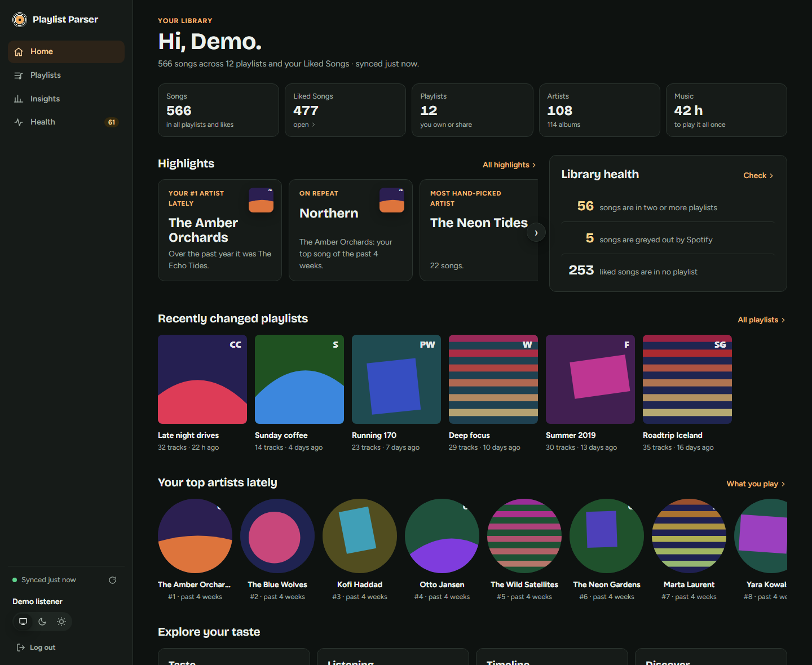

*Screenshots use the built-in demo mode with made-up data (see [Demo mode](#demo-mode)).*

## Architecture

| Component | Technology | Notes |
|-----------|------------|-------|
| `frontend/` | Vue 3, Vue Router, Vite | Static single-page app. Calls the API with cookies (`credentials: 'include'`). |
| `api/` | Node.js 22+, Fastify 5, Prisma 7 (node-postgres driver adapter) | Spotify OAuth, statistics, CSV export, library sync, enrichment. Stateless: all state lives in PostgreSQL. |
| Database | PostgreSQL | Users, sessions, encrypted Spotify tokens, export jobs, synced library, caches of public music data. |

External services the API talks to (outbound HTTPS):

- **Spotify Web API** (`accounts.spotify.com`, `api.spotify.com`): required.
- **Last.fm API** (`ws.audioscrobbler.com`): optional (`LASTFM_API_KEY`): listener counts, artist tags and similar artists.
- **Deezer API** (`api.deezer.com`): no key: song tempo (BPM).
- **MusicBrainz** (`musicbrainz.org`): no key: artist countries, composers of classical recordings.

Library-wide data is copied to the database by a background **library sync** (only playlists that changed are re-read), followed by a background **enrichment** job that looks up public data per song and artist. Both report progress in the UI, are shared by all API instances, and are rate-limited per service (MusicBrainz allows one request per second, so the first enrichment of a large library takes 10–15 minutes).

## Features

The app has four sections, in a side rail on desktop and a tab bar on phones: **Home**, **Playlists**, **Insights** and **Health**. Library sync, public-data lookups and CSV exports report their progress in one status area. It has a dark theme (the default) and a light theme; it follows the device setting unless you pick one.

- **Home**: totals for your whole library, highlight cards, library health counts, recently changed playlists and your top artists lately.
- **Playlists**: all your playlists with **Liked Songs** pinned first and treated like a playlist. Playlists you only *follow* are listed but can't be analyzed (see [Spotify limitations](#spotify-limitations)). Search, filter and sort are kept in the URL.
- **Playlist page**: track/artist counts, top artists and albums, length, explicit share, release decades, when tracks were added, contributors on collaborative playlists, Last.fm listener counts (most listened and hidden gems), duplicates within the playlist (same track, or the same recording on another release), and a track table you can filter and sort.
- **Compare two playlists**: songs only in A, in both, and only in B, and what merging one into the other would add.
- **Health**: the same song (recording) in two or more playlists, songs Spotify greys out, and liked songs that are in no playlist.
- **Artist and album pages**: everything in your library by one artist or from one album: your songs and which playlists they're in, likes per year, how much of an album you have, tags, origin and similar artists. Names everywhere link to these pages; "Open in Spotify" is always one click away.
- **CSV export** of one playlist, or of all your playlists as a background job.
- Liked Songs separates songs you **liked one by one** from **whole albums you saved** (Spotify adds every track of a saved album). One setting, "Count songs from saved albums", applies to every page.
- **Share cards**: save any highlight, or the summary of your taste, as a 1080×1920 image (story format). Phones open the share sheet; desktops download a PNG.
- Every chart has a **Show as list** view with the same data as a table, for keyboard and screen-reader users.

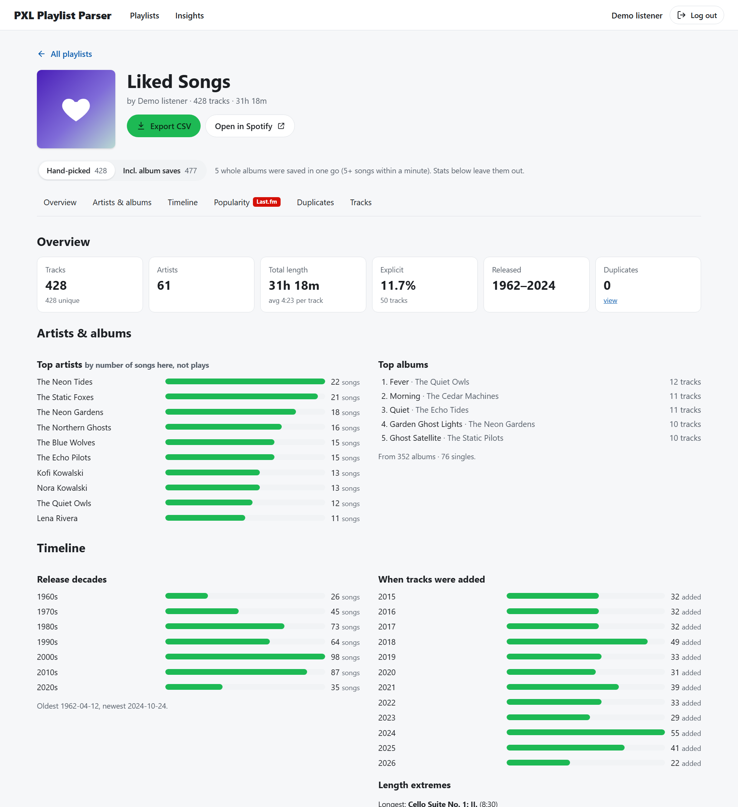

| | |
|---|---|
| 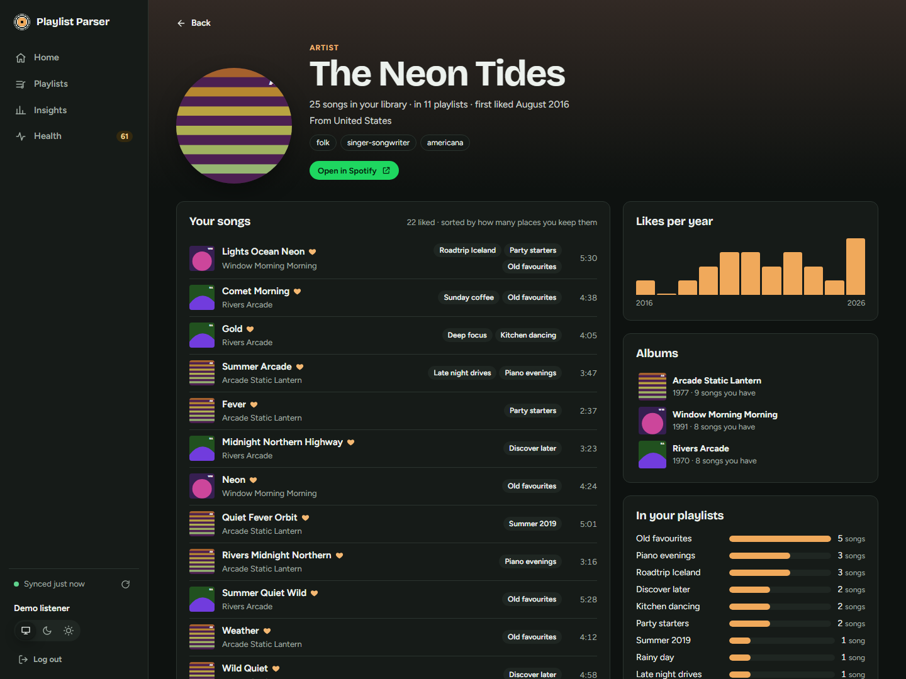 | 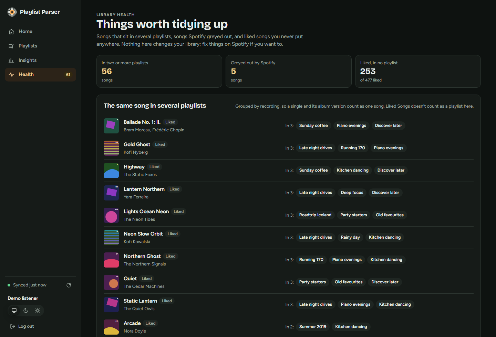 |
| **Artist page**: your songs by one artist, where you keep them, likes per year, albums and similar artists. | **Health**: songs in several playlists, songs Spotify greyed out, liked songs in no playlist. |
| 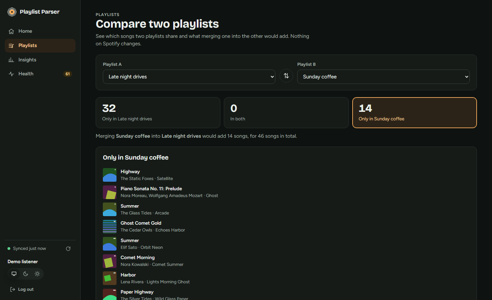 | 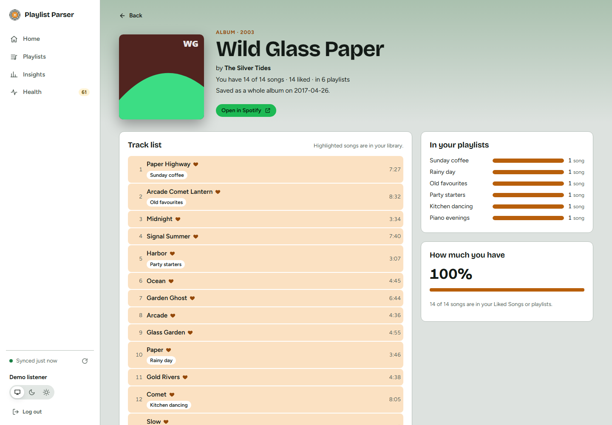 |
| **Compare**: only in A, in both, only in B. | **Light theme**, here on an album page with its full track list. |

On phones the side rail becomes a tab bar at the bottom:

| | | |
|---|---|---|
| 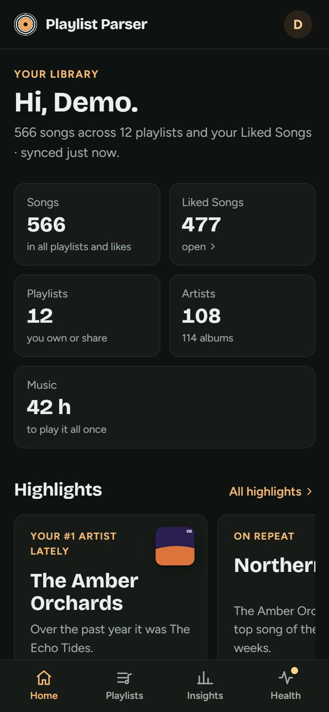 | 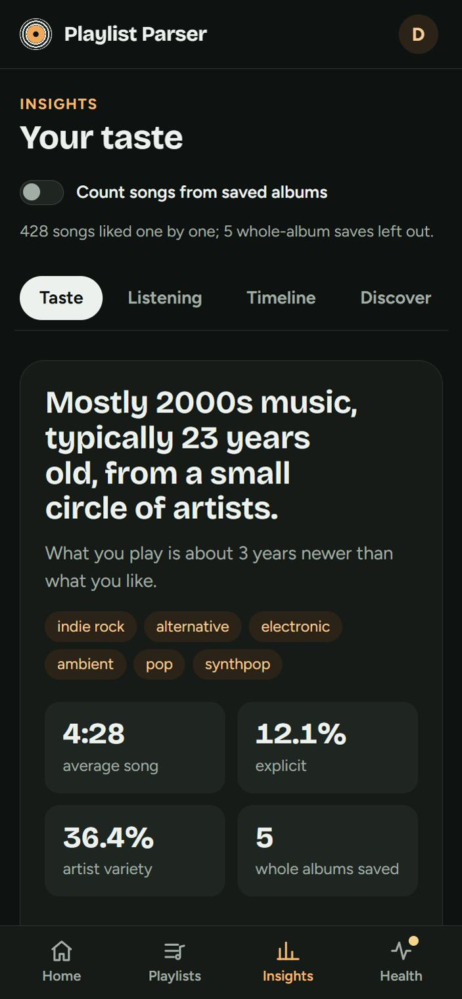 | 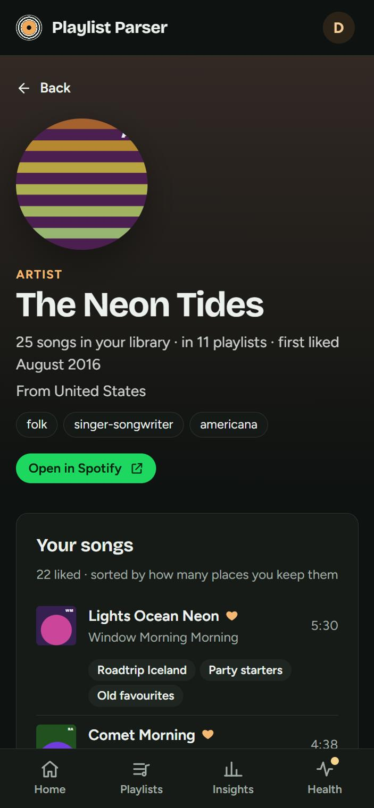 |

### Animations

The app is deliberately playful. **Zen mode** (next to the theme switch) turns every animation off, and the app starts in Zen mode when the device asks for reduced motion.

- **Record player**: play buttons on covers and sound-map dots play a 30-second preview (from Deezer: Spotify no longer offers previews). A vinyl slides out of the cover and spins at the song's tempo, with bars around it that follow the real audio.
- **Page transitions**: pages slide in, and a clicked cover flies into the next page's header (View Transitions API).
- **Animated background**: a WebGL "liquid aurora" in the colour of the cover on screen, which swells with the music while a preview plays.
- Numbers count up, bars grow and covers cascade in as you scroll; charts glide to new values, covers slide to their new rank, and the artist constellation can be dragged around.
- **Sound map time-lapse**, **Cover Flow** for playlists, confetti when an export finishes, an opening sequence on Home, a scratchable record logo and a cursor trail.
- **Disco mode**: the switch, or ↑ ↑ ↓ ↓ ← → ← → B A.

### Insights

Four pages about your taste rather than one playlist, built from your Liked Songs, your Spotify top artists and tracks, your recent plays and public music data.

| | |
|---|---|
| 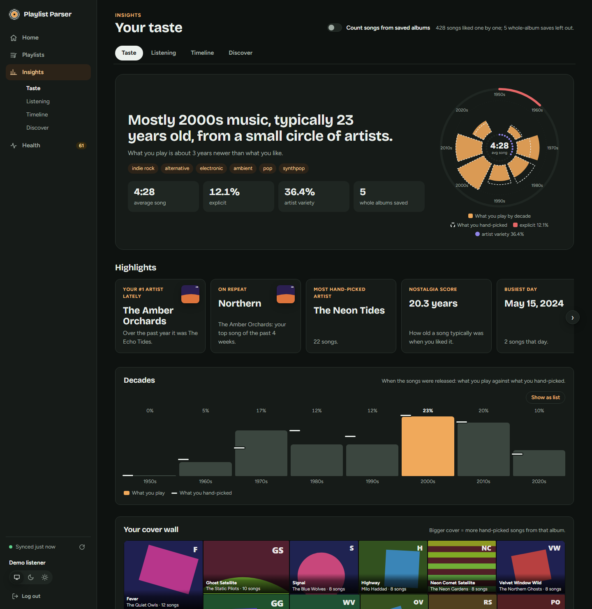 | 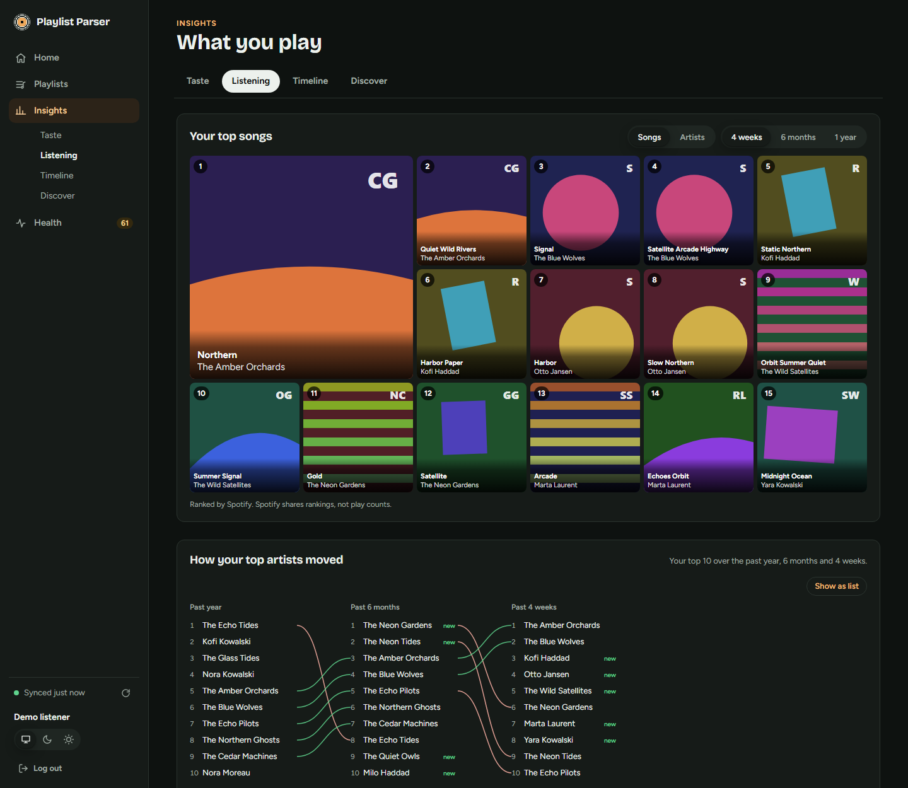 |
| **Taste**: a one-line summary of your taste with its fingerprint, highlight cards, release decades (what you play against what you like), the cover wall, music age and song length, artist depth, genres and a classical corner. | **Listening**: your top songs and artists over 4 weeks, 6 months and a year, how your top artists moved, when you listen, recent plays, followed artists, saved albums and podcasts. |
| 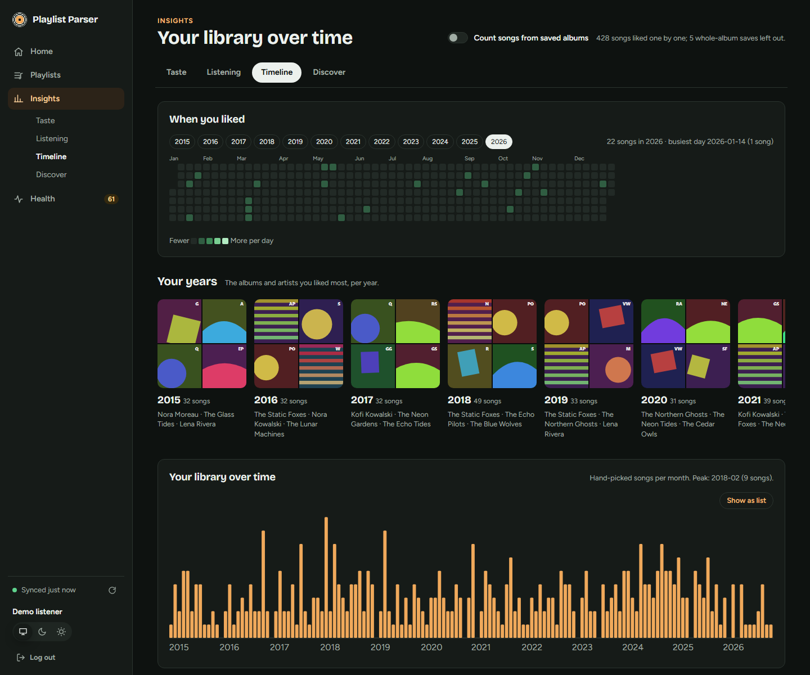 | 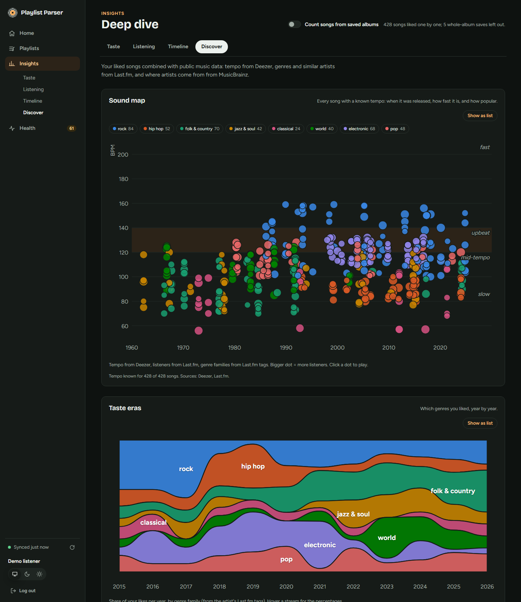 |
| **Timeline**: a like calendar, your albums and artists per year, library growth per month and whole-album saves. | **Discover**: the sound map (release year against tempo from Deezer), taste eras (genre families per year from Last.fm tags), the music atlas (artist origins from MusicBrainz) and the artist constellation. |

## Spotify limitations

Spotify changed its Web API for apps in *Development Mode* in February/March 2026. This app follows the new rules:

- The **owner of the Spotify app must have Spotify Premium**, or the app stops working.
- A development-mode app allows **at most 5 users**. Every account other than the owner must be added under *User Management* in the Spotify dashboard, or login fails with "user not allowed".
- Playlist contents are only available for playlists the user **owns or collaborates on**.
- Track `popularity` and the user's `email` are no longer available. Last.fm listener counts replace popularity.

The app requests these read-only scopes: `playlist-read-private`, `playlist-read-collaborative`, `user-library-read` (Liked Songs, saved albums and podcasts), `user-top-read` (top artists and tracks), `user-read-recently-played` (last 50 plays) and `user-follow-read` (followed artists). Users who logged in before a scope was added must log in again; the app asks them to.

## Spotify app setup

1. Go to the [Spotify Developer Dashboard](https://developer.spotify.com/dashboard) and create an app (Web API).
2. Add a **Redirect URI** that points at the API's callback: `<API URL><API_BASE_PATH>/auth/callback`.
   - Locally: `http://127.0.0.1:3000/auth/callback`
   - Spotify only allows plain `http` for loopback IP addresses like `127.0.0.1`. `localhost` is rejected, and every other host must use `https`.
   - The value must match `SPOTIFY_REDIRECT_URI` exactly.
3. Copy the Client ID and Client secret into the API configuration.
4. Add the Spotify accounts that will log in under *User Management*.

## Last.fm setup (optional)

Create an API account at <https://www.last.fm/api/account/create> (the callback URL can stay empty) and set `LASTFM_API_KEY`. Without it the app still works, but listener counts, genre tags and similar artists are missing: the playlist page and the Insights Discover page say so, and the taste eras, genres, artist constellation and similar artists stay empty. The key is a server-side secret: it belongs in the API's environment, never in the frontend build.

Deezer and MusicBrainz need no account or configuration; the API only needs outbound internet access to them.

## Configuration

Everything that differs between environments is configured with environment variables; no code changes are needed. The API validates its configuration at startup and exits with a list of everything that is wrong.

### API (`api/`)

| Variable | Required | Default | Description |
|----------|----------|---------|-------------|
| `DATABASE_URL` | yes | | PostgreSQL connection string. |
| `SPOTIFY_CLIENT_ID` | yes | | From the Spotify dashboard. |
| `SPOTIFY_CLIENT_SECRET` | yes | | From the Spotify dashboard. |
| `SPOTIFY_REDIRECT_URI` | yes | | Full callback URL, registered in the Spotify dashboard. Its path must be `<API_BASE_PATH>/auth/callback`. |
| `SESSION_SECRET` | yes | | Signs the session cookie. At least 32 characters. |
| `TOKEN_ENC_KEY` | yes | | Encrypts Spotify refresh tokens at rest. Exactly 64 hex characters. |
| `FRONTEND_ORIGIN` | no | `http://127.0.0.1:5173` | URL of the frontend; the browser is sent there after login. |
| `CORS_ORIGINS` | no | origin of `FRONTEND_ORIGIN` | Comma-separated origins allowed to call the API with cookies. `*` is not allowed. |
| `COOKIE_SAMESITE` | no | `lax` | `lax`, `strict` or `none` (`none` requires `COOKIE_SECURE=true`). |
| `COOKIE_SECURE` | no | `false` | Mark cookies `Secure` (https only). |
| `COOKIE_DOMAIN` | no | | Cookie domain, e.g. to share it across subdomains. |
| `SESSION_TTL_DAYS` | no | `7` | Session lifetime. |
| `API_BASE_PATH` | no | *(empty)* | Serve every route, including probes, under a prefix such as `/api`. |
| `TRUST_PROXY` | no | `false` | Trust `X-Forwarded-*` headers: `true`, a hop count, or comma-separated IPs/CIDRs. Determines the client IP used for rate limiting and logs. |
| `RATE_LIMIT_MAX` / `RATE_LIMIT_WINDOW_SECONDS` | no | `120` / `30` | Requests per client IP per window. |
| `PORT` / `HOST` | no | `3000` / `0.0.0.0` | Listen address. |
| `LOG_LEVEL` | no | `info` | Fastify/pino log level. |
| `NODE_ENV` | no | | `production` or `development`. |
| `LASTFM_API_KEY` | no | | Enables Last.fm listener counts, tags and similar artists. |
| `LASTFM_CACHE_DAYS` | no | `30` | How long Last.fm listener counts are cached. |

Generate secrets with:

```bash
node -e "console.log(require('crypto').randomBytes(32).toString('hex'))"
```

Some things to know about cookies: the session cookie is set by the **API's** host. Browsers only send it along with the frontend's API calls when the cookie settings fit how the frontend and API are hosted relative to each other (same origin, same site, or cross-site). Check the API's `configuration` log line at startup to see the effective values.

### Frontend (`frontend/`)

| Variable | Default | Description |
|----------|---------|-------------|
| `VITE_API_BASE_URL` | *(empty = same origin)* | Base URL of the API, including `API_BASE_PATH`. **Baked in at build time**: changing it requires a new `npm run build`. |

### Database

Apply migrations with `npm run db:migrate` (runs `prisma migrate deploy`) in `api/` before starting the API, and again after every update. The Prisma client must be generated (`npm run db:generate`) after installing dependencies. Both need the `prisma` CLI (a dev dependency) and read `api/prisma.config.js`; `db:migrate` also needs `DATABASE_URL`. Prisma 7 has no native query engine, so no OpenSSL or other system libraries are required.

## API endpoints

All paths are relative to `API_BASE_PATH`.

```text
GET  /auth/login                         start Spotify OAuth
GET  /auth/callback                      OAuth redirect target
POST /auth/logout                        end the session

GET  /me                                 current user
GET  /me/playlists                       all playlists (with an `analyzable` flag) and Liked Songs

GET  /playlists/:id/contents             tracks
GET  /playlists/:id/stats                statistics
GET  /playlists/:id/listeners            Last.fm listener stats (poll until complete)
GET  /playlists/:id/simulate-dedupe      duplicate report (read-only)
GET  /playlists/:id/export               CSV download
GET  /simulate-merge?a=PL1&b=PL2         compare two playlists (counts, plus the songs only in A, in both, only in B)

POST /playlists/export-all               start a bulk export job
GET  /playlists/export-progress/:jobId   job progress
GET  /playlists/download/:jobId          download a finished export

GET  /insights/summary                   Liked Songs stats + top artists/tracks + recent plays
GET  /insights/collection                followed artists, saved albums, podcasts
GET  /insights/deep?lens=handpicked|all  sound map, eras, atlas, constellation, tags, classical
GET  /insights/overlap                   Liked Songs vs. playlists (from the synced library)
GET  /insights/unplayable                songs Spotify greys out (from the synced library)

GET  /library/sync                       library sync progress
POST /library/sync                       start a library sync
GET  /library/enrichment                 enrichment progress per source
POST /library/enrichment                 start enrichment
GET  /library/overview                   totals, health counts, recently changed playlists (synced library)
GET  /library/duplicates                 the same recording in two or more playlists (synced library)
GET  /library/artists/:id                everything in the library by one artist (Spotify artist id)
GET  /library/albums/:id                 your songs from one album, with its track list (Spotify album id)

GET  /healthz                            liveness (no database check)
GET  /readyz                             readiness (checks the database)
GET  /metrics                            Prometheus metrics
```

Under `/playlists`, `:id` is a Spotify playlist id, or `liked` for the user's Liked Songs. `POST` requests must use `Content-Type: application/json`. The API closes gracefully on `SIGTERM`.

## Local development

Requirements: Node.js 22.9+ and Docker (for PostgreSQL only).

```bash
# 1. Database
docker compose up -d

# 2. API (http://127.0.0.1:3000)
cd api
cp .env.example .env      # fill in Spotify credentials and generate the secrets
npm install
npm run db:generate
npm run db:migrate
npm run dev

# 3. Frontend (http://127.0.0.1:5173), in a second terminal
cd frontend
cp .env.example .env
npm install
npm run dev
```

Open <http://127.0.0.1:5173> (not `localhost`; the Spotify redirect and the cookies are tied to `127.0.0.1`) and click **Log in with Spotify** on the welcome page:

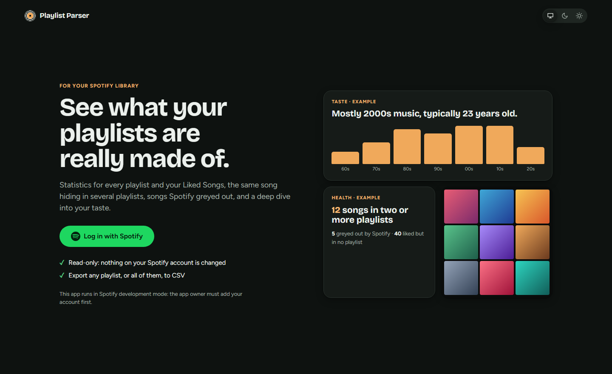

Run the API unit tests with `npm test` in `api/`.

### Demo mode

The frontend can run without the API, on generated, made-up data (used for the screenshots in this README):

```bash
cd api && npm run demo:fixtures      # writes frontend/src/demo/ and frontend/public/demo/ (git-ignored)
cd ../frontend && VITE_DEMO=true npm run dev
```

The fixtures are produced by running the API's own statistics code on a fake library, so the demo shows exactly what the real app computes. Normal builds never include them. Build the frontend for production with `npm run build` in `frontend/`; the output in `dist/` is a static site.
